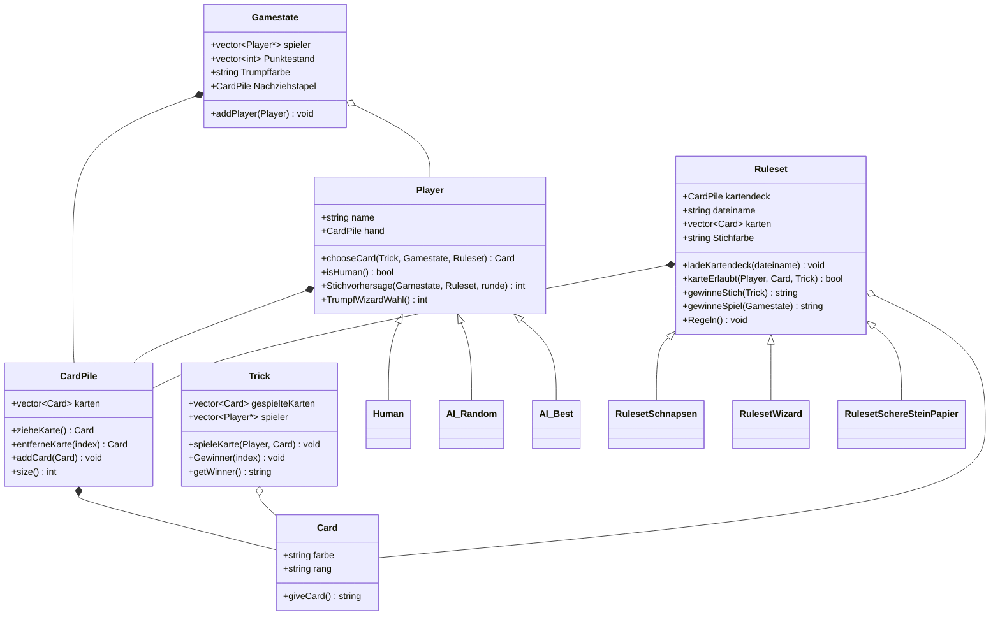

## Object Oriented Card Games (C++)

Software development project focusing on object-oriented design, clean header/implementation separation, game state management, and easy expansion in C++.

# Architecture
Clean separation of class classification (.h) and implentation (.cpp) among the game entity.
The structure is shown in `UML-Klassendiagramm C++ Card Game.pdf`.



# How to Compile and Run
```bash
g++-std=c++17 cardgame.cpp cardpiles.cpp game.cpp game engine.cpp player.cpp schnapsn.cpp wizard.cpp scheresteinpapier.cpp -o spiel
./spiel
```
